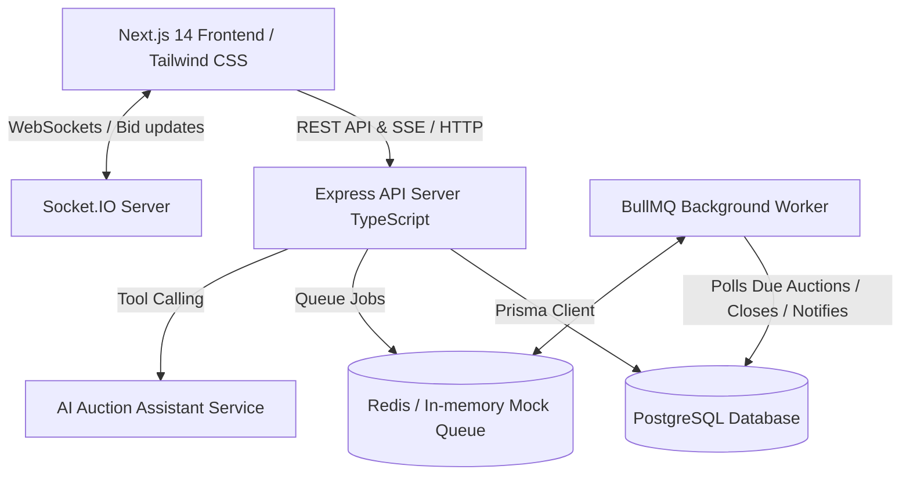

# Campus Auction Marketplace

A production-grade, campus-focused auction marketplace where verified university students list items, place bids, compete through transparent real-time bidding, and complete handover verifications with anti-sniping protection and automated seller decision workflows.

## System Architecture

## Directory Structure (Monorepo)

- `apps/web`: Next.js frontend with Tailwind CSS, Lucide icons, Hook Form + Zod, Socket.IO client.
- `apps/api`: Express.js backend with TypeScript, Prisma ORM, Socket.IO server, Auth with JWT & HttpOnly cookies, Bidding Engine with row-level transactional isolation.
- `apps/worker`: BullMQ background job processor for auction closing, saved-search alerts, and deadline extensions.
- `packages/shared`: Shared TypeScript types, validation schemas (Zod), and event definitions.
- `docs/`: System architecture, ER diagram, bidding state machine, and OpenAPI specifications.

## Database Models

- `User`: Accounts with role-based access (`STUDENT`, `ADMIN`), campus email, verification status.
- `AuctionListing`: Listings with starting price, minimum increment, condition, status, pickup location, closing deadline.
- `Bid`: Immutable history of accepted bids with timestamps, amounts, bidder aliases.
- `AutoBidLimit`: Private student proxy bidding limits with concurrency protection.
- `Question` & `QuestionAnswer`: Q&A threads per listing.
- `SavedSearch` & `SavedListing`: Notification triggers for students.
- `Notification`: In-app persistent alerts with read states.
- `AuditLog`: Admin and transaction event audit trail.
